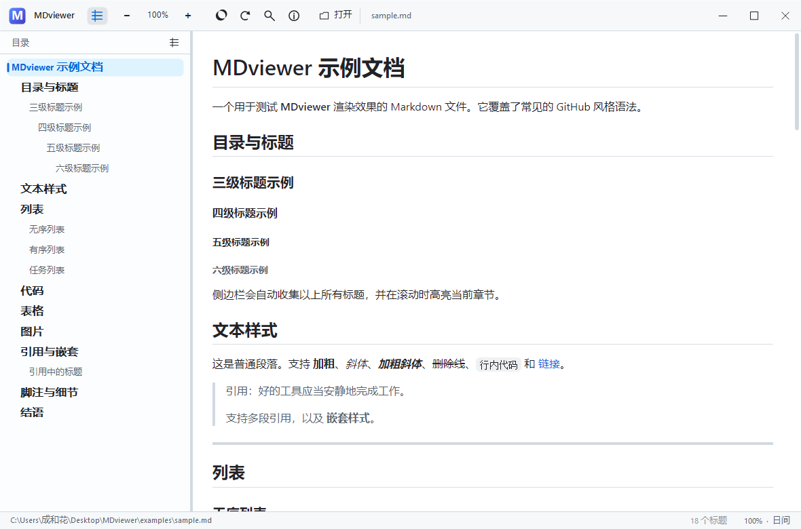
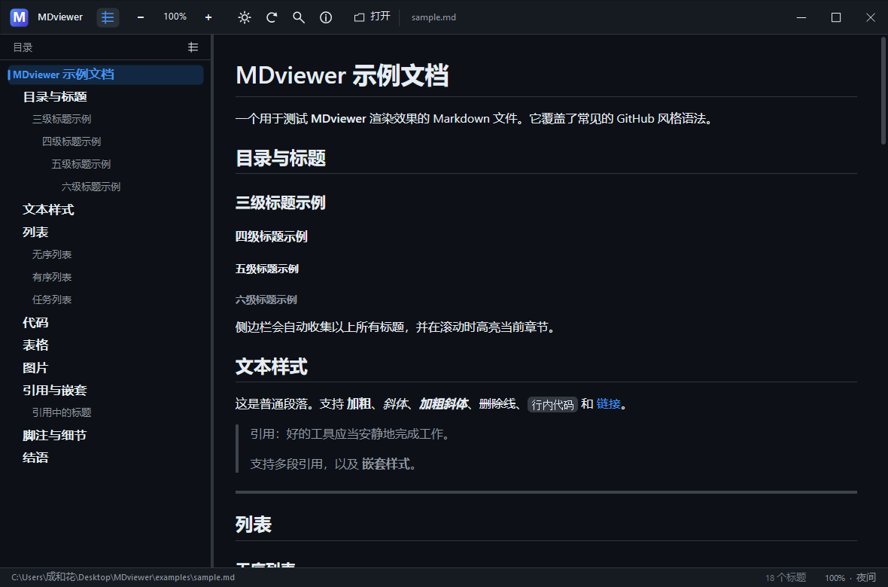

# MDviewer

当前版本：**1.01**

一个轻量、离线、顺手的 **Markdown 阅读器**。界面参考 GitHub 的 Markdown 排版，启动快、无广告、不联网，双击 `.md` 文件即可舒适阅读。





---

## 功能特性

| 功能 | 说明 |
| --- | --- |
| **可开关的侧边栏** | 自动提取文档中的章节标题，按层级缩进展示；点击即可跳转，滚动时实时高亮当前章节。支持拖动调整宽度。 |
| **日间 / 夜间模式** | 一键切换，配色参照 GitHub。工具栏、侧边栏、状态栏与正文一起换肤。 |
| **字体缩放** | 通过工具栏 `A- / A+` 按钮、`Ctrl + 鼠标滚轮` 或 `Ctrl + + / -` 调整正文字号，`Ctrl + 0` 恢复 100%。设置自动记忆。 |
| **GitHub 风格排版** | 标题、引用、表格、任务列表、删除线、行内代码、代码块语法高亮、图片等均按 GitHub 网页的 Markdown 样式渲染。 |
| **宽度自适应** | 正文宽度跟随窗口变化，不会出现固定窄栏；窄窗口下工具栏会自动精简按钮。 |
| **全文查找** | `Ctrl + F` 打开查找栏，命中关键词高亮显示，`Enter` / `Shift+Enter` 在上一个、下一个结果间跳转。 |
| **设为默认打开方式** | 在「关于」窗口中点击「设为默认 Markdown 应用」即可注册为 `.md` 等格式的打开方式。 |
| **关于界面** | 按 `F1` 或点击工具栏信息按钮，查看版本、功能简介与运行环境说明。 |
| **广泛兼容** | 目标框架 .NET Framework 4.5+，渲染引擎使用系统 WebView2，支持 **Windows 7 SP1 及更高版本**。 |

其他细节：

- 单实例运行：再次双击文件会在已打开的窗口中切换文档。
- 支持拖放文件到窗口打开。
- 自动识别 UTF-8 / UTF-16 / GBK 编码。
- 记住窗口位置、大小、侧边栏宽度、主题与字号。
- 相对路径图片按 Markdown 文件所在目录解析。
- 外链使用系统默认浏览器打开。
- 按住鼠标右键向上或向下拖动，可快速回到文档开头或结尾。

---

## 系统要求

| 组件 | 要求 |
| --- | --- |
| 操作系统 | Windows 7 SP1 / 8 / 8.1 / 10 / 11（32 位或 64 位） |
| .NET Framework | 4.5 或更高版本（推荐 4.8；Windows 10/11 已自带） |
| WebView2 运行时 | Windows 10/11 通常已内置；Windows 7/8.1 需安装 Microsoft Edge WebView2 Runtime |

> **Windows 7 提示**：请先安装 .NET Framework 4.8 与支持 Windows 7 的 WebView2 运行时（例如 109.x 版本），再运行 MDviewer。

---

## 安装与使用

### 方式一：安装包

1. 运行 `MDviewer-Setup-x.x.x.exe`。
2. 按向导完成安装（默认安装到当前用户目录，无需管理员权限）。
3. 安装过程中可选择“将 MDviewer 注册为 Markdown 文件的打开方式”。

### 方式二：便携版

解压 `MDviewer-portable.zip` 后直接运行 `MDviewer.exe`，无需安装。

### 打开文档

- 启动后点击工具栏「打开」，或按 `Ctrl + O`；
- 直接把 `.md` 文件拖进窗口；
- 在资源管理器中右键 `.md` 文件 →「打开方式」→ 选择 MDviewer；
- 设为默认应用后，双击 `.md` 文件即可直接打开。

### 设为默认打开方式

打开「关于」窗口（工具栏 ⓘ 或 `F1`），点击 **设为默认 Markdown 应用**：

- **Windows 7**：会直接写入当前用户的文件关联。
- **Windows 8 / 10 / 11**：系统出于安全限制不允许程序静默修改默认应用，MDviewer 会注册为候选应用并打开「默认应用」设置页，请在其中为 `.md` 选择 MDviewer。

安装包也会自动完成候选应用注册。

---

## 快捷键

| 快捷键 | 功能 |
| --- | --- |
| `Ctrl + O` | 打开文件 |
| `Ctrl + B` | 显示 / 隐藏侧边栏 |
| `Ctrl + F` | 查找 |
| `Enter` / `Shift + Enter` | 下一个 / 上一个查找结果 |
| `Esc` | 关闭查找栏 |
| `Ctrl + T` | 切换日间 / 夜间模式 |
| `Ctrl + +` / `Ctrl + -` | 放大 / 缩小字号 |
| `Ctrl + 鼠标滚轮` | 缩放字号 |
| `Ctrl + 0` | 重置字号为 100% |
| `F5` | 重新载入当前文件 |
| `F1` | 关于 MDviewer |
| 按住鼠标右键向上 / 向下拖动 | 回到页首 / 页尾 |

---

## 从源码构建

环境要求：Windows、.NET Framework 4.x（自带 `csc.exe` 即可），无需安装 Visual Studio 或 Node.js。

```bat
:: 生成便携版（build\MDviewer\ 与 build\MDviewer-portable.zip）
build.cmd
```

### 生成安装包

1. 安装 [Inno Setup 6](https://jrsoftware.org/isdl.php)。
2. 执行：

```powershell
powershell -ExecutionPolicy Bypass -File installer\build-installer.ps1
```

生成 `build\MDviewer-Setup-1.01.exe`。

> 构建脚本会复用 `vendor\webview2` 中的 WebView2 SDK 程序集与加载器，因此完全离线可构建。

---

## 项目结构

```
MDviewer/
├─ build.cmd / build.ps1          # 编译、打包便携版
├─ src/MDviewer/
│  ├─ Program.cs                  # 入口、单实例、命令行
│  ├─ MainForm.cs                 # 主窗口、工具栏、侧边栏、查找、WebView2 桥接
│  ├─ AboutForm.cs                # 关于窗口（含设为默认应用）
│  ├─ AppResources.cs             # 运行时生成应用图标
│  ├─ Core/
│  │  ├─ MarkdownParser.cs        # 零依赖 Markdown 解析器
│  │  ├─ Highlighter.cs           # 轻量语法高亮
│  │  ├─ DocumentRenderer.cs      # 生成 HTML、图片路径重写、编码识别
│  │  ├─ Settings.cs              # 偏好持久化
│  │  └─ FileAssociation.cs       # 文件关联注册
│  ├─ UI/                         # 自绘标题栏、按钮、图标、大纲列表、查找栏
│  └─ web/
│     ├─ github.css               # GitHub 风格样式（日间）
│     ├─ theme-dark.css           # 夜间主题
│     └─ runtime.js               # 主题/字号/滚动同步/查找高亮
├─ vendor/webview2/               # WebView2 SDK（随仓库提供，离线构建）
├─ installer/                     # Inno Setup 脚本
├─ tools/make_icon.py             # 多尺寸高清图标生成脚本
├─ examples/sample.md             # 功能演示文档
└─ docs/screenshots/              # 截图
```

### 技术说明

- **界面**：C# / WinForms，自绘无边框窗口，保证 Windows 7 以来一致的深色主题表现。
- **渲染**：Microsoft Edge WebView2（Chromium 内核）承载 HTML；Markdown 解析与语法高亮由本项目自行实现，不引入第三方运行时依赖。
- **资源加载**：通过 WebView2 的虚拟主机映射加载样式、脚本与文档；本地图片通过映射 Markdown 所在目录解析，避免 `file://` 跨域问题。
- **安全**：生成的 HTML 带有 CSP；Markdown 中的 `<script>`、`on*` 事件属性与 `javascript:` URL 会被过滤。

---

## 已知限制

- YouTube 等需要联网的嵌入内容不会加载（离线优先，CSP 默认禁止外部脚本与 iframe）。
- Windows 8 及以上无法由程序静默设置默认应用，这是系统限制；需要用户在「默认应用」中确认一次。
- 语法高亮为轻量实现，覆盖常见语言（C/C++/C#/Java/JS/TS/Python/Go/Rust/PHP/SQL/HTML/CSS/JSON/YAML/Shell 等），并非完整的 IDE 级高亮。

---

## 第三方组件

- [Microsoft Edge WebView2 SDK](https://learn.microsoft.com/microsoft-edge/webview2/) — 见 `vendor/webview2/LICENSE.txt` 与 `NOTICE.txt`。

本项目自身代码以 MIT 许可证发布，详见 [LICENSE](LICENSE)。
